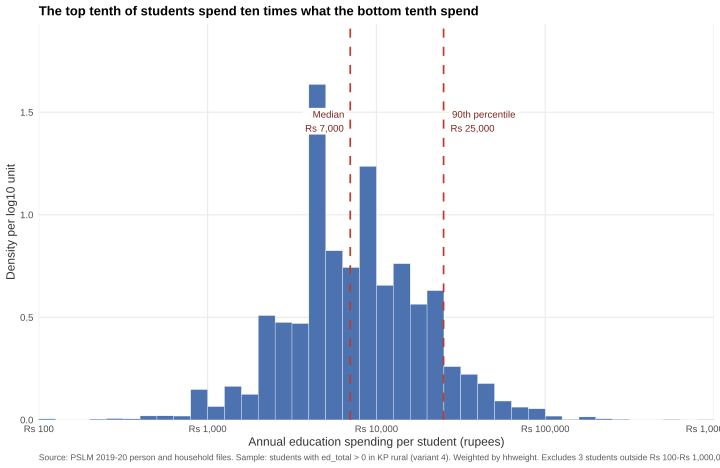
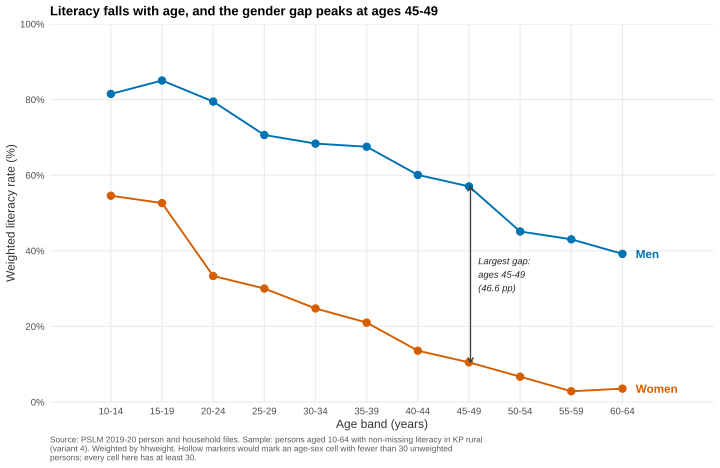
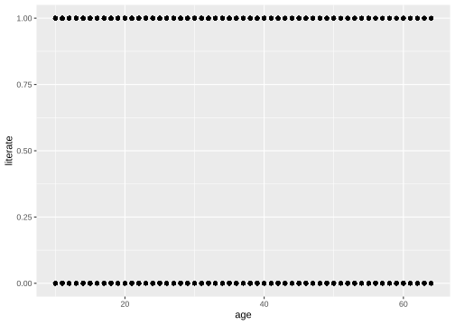
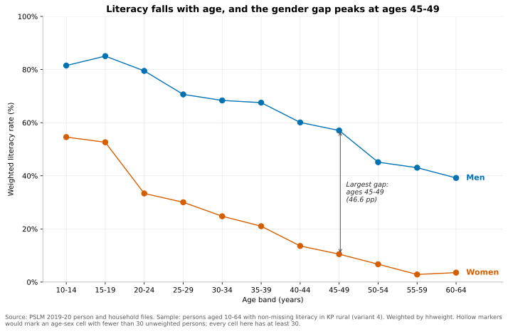

# ECO346 Assignment 1 — FA24-BEDS-052

**Variant 4: Khyber Pakhtunkhwa, rural.**
Registration number FA24-BEDS-052 gives 52 = 6 × 8 + 4, so the remainder is 4.

This repository contains the R and Python code, figures and slides for the PSLM
2019–20 analysis. The scripts read the local CSV files in `data/`, so a fresh
clone reproduces every figure and number without internet access.

## Repository contents

```
README.md
data/       pslm_person_subset.csv, pslm_hh_subset.csv
scripts/    01_distribution.R, 02_default.R, 03_literacy.R, 04_literacy.py
figures/    distribution.svg, default.svg, literacy.svg, literacy_python.svg
slides/     FA24-BEDS-052.pptx
```

## Reproducing the results

Run from the repository root (the scripts also locate the root automatically):

```bash
Rscript scripts/01_distribution.R
Rscript scripts/02_default.R
Rscript scripts/03_literacy.R
python scripts/04_literacy.py
```

R is used for Questions 2, 3 and 4. Python is the second language for Question 5.
The R scripts use `ggplot2` and `svglite`; the Python script uses `pandas` and
`matplotlib`.

## Question 2 — The distribution



**Numbers.** Students with `ed_total > 0`: **4,912**. Weighted median:
**Rs 7,000**. Unweighted median: **Rs 7,000**. Weighted 10th percentile:
**Rs 2,500**. Weighted 90th percentile: **Rs 25,000**. Ratio of the 90th to the
10th percentile: **10.00**. Students excluded outside Rs 100–Rs 1,000,000:
**3**.

**What the figure shows (77 words).** The distribution is strongly
right-skewed: most KP rural students cost a few thousand rupees a year, but a
thin upper tail reaches Rs 1 million. The weighted 90th percentile is ten times
the 10th (Rs 25,000 versus Rs 2,500). Weighted and unweighted medians are both
Rs 7,000, so reweighting does not move the midpoint; the household weights are
balanced around that value, and the median therefore does not change when large
households count more.

## Question 3 — The relationship



**Numbers.** Women aged 15–19: **52.6%**; men aged 15–19: **85.1%**. Women aged
55–59: **2.9%**; men aged 55–59: **43.0%**. The largest gender gap is in the
**45–49** band: women **10.5%**, men **57.0%**, a gap of **46.6 percentage
points**.

### Band table

| Age band | Men (N) | Men weighted % | Women (N) | Women weighted % |
|---|---:|---:|---:|---:|
| 10–14 | 1,439 | 81.5 | 1,210 | 54.6 |
| 15–19 | 1,162 | 85.1 | 985 | 52.6 |
| 20–24 | 768 | 79.5 | 906 | 33.3 |
| 25–29 | 580 | 70.6 | 826 | 30.0 |
| 30–34 | 499 | 68.4 | 588 | 24.8 |
| 35–39 | 421 | 67.5 | 546 | 21.0 |
| 40–44 | 357 | 60.1 | 449 | 13.6 |
| 45–49 | 385 | 57.0 | 392 | 10.5 |
| 50–54 | 278 | 45.1 | 384 | 6.7 |
| 55–59 | 255 | 43.0 | 308 | 2.9 |
| 60–64 | 272 | 39.2 | 190 | 3.6 |

Every age–sex cell has at least 30 unweighted persons, so no hollow (thin)
markers appear in this variant.

**Interpretation (87 words).** Literacy falls monotonically with age for both
sexes, consistent with cohort replacement: younger cohorts had more schooling,
while older cohorts, especially women, often had none. The gender gap is widest
at ages 45–49, where men's literacy is 57.0% and women's 10.5%, a 46.6-point
gap. This pattern is consistent with supply-side and social constraints on
girls' education in earlier decades. The cross-section cannot tell us whether
schooling caused later literacy, nor when any individual became literate; it
records only current status by age and sex.

## Question 4 — The makeover

**Default (committed before the redesign):**



**Redesign (the Question 3 figure):**


**Redesign explanation (148 words).** The default plot puts individual age on
the x-axis and the 0/1 literacy indicator on the y-axis; 13,200 points collapse
into two horizontal bands, so the age pattern is invisible. I made four changes.
First, I replaced raw points with weighted conditional means by age band, which
directly addresses **overplotting** and exposes the conditional relationship.
Second, I mapped sex to two colour-coded lines and labeled each series at its
end; colour is a strong **perceptual channel**, and direct labels replace a
legend lookup, improving **data–ink**. Third, I fixed the y-axis at 0–100% and
labeled bands at their midpoints, so differences are read on a common, honest
scale rather than as 0/1 noise. Fourth, hollow markers flag thin cells, making
uncertainty visible. The default shows every individual observation and the full
dispersion within each age; the redesign hides that dispersion and shows only
the conditional means.

## Question 5 — A second language

The Python script `scripts/04_literacy.py` recomputes the band table and redraws
the Question 3 figure as `figures/literacy_python.svg`. Its band table matches
the R table to one decimal place.



**Numbers.** Women aged 15–19: **52.6%** from R and **52.6%** from Python.

**What differed (52 words).** Matplotlib, unlike ggplot2, did not default to a
0–100 y-axis and filled every marker. I set `ylim(0, 100)`, used the same
0.1-wide age bands and midpoints, the same `hhweight` weighting, matching
colours, and hollow circle markers for thin cells. Both languages produce the
same band table to one decimal place.

## Question 6 — Presentation

The four-slide PowerPoint is `slides/FA24-BEDS-052.pptx`. It shows the variant,
the makeover (default and redesign side by side), and the main finding.

